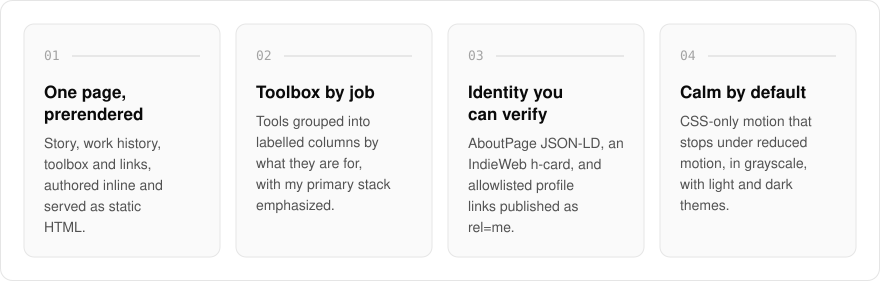
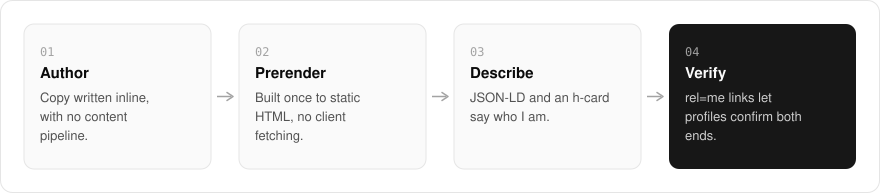

  <picture>
    <source media="(prefers-color-scheme: dark)" srcset=".github/assets/hero-dark.png">
    
  </picture>

<h1 align="center">about.me.at</h1>

<strong>About me: my background, skills, and the path so far as a full-stack software engineer.</strong>

  
  
  

  <a href="https://about.me.at">Website</a> ·
  <a href="#features">Features</a> ·
  <a href="#how-it-works">How it works</a> ·
  <a href="#built-with">Built with</a>

A resume flattens a career into dates and bullet points. I built about.me.at to hold the parts it leaves out: how I got into software, where the years went, the tools I reach for, and how to find me elsewhere. It is deliberately the smallest shape in my family of apps: one page, authored inline, prerendered to static HTML, with no content pipeline and no client-side fetching.

  <picture>
    <source media="(prefers-color-scheme: dark)" srcset=".github/assets/overview-dark.svg">
    
  </picture>

## Why about.me.at

- **What a resume leaves out**: the story, the work history and the toolbox, told in my own words on one page.
- **Small on purpose**: authored inline and prerendered, so a visit is plain static HTML with nothing to fetch.
- **Verifiable**: profile links are allowlisted and published as `rel="me"` and `sameAs`, so they can be checked from the other end.

## Features

- **One static page**: a hero, a toolbox band, a facts strip, then the story, work history, network, elsewhere, and colophon sections, prerendered to static HTML.
- **Toolbox by job**: tools grouped into labelled columns by what they are used for, with the primary stack emphasized.
- **Facts strip**: years of experience, career track, and location, kept in one place so they stay current.
- **Structured identity**: schema.org `AboutPage` JSON-LD and an IndieWeb h-card on the page.
- **Verified profiles**: outbound profile links are allowlisted and published as `rel="me"` and `sameAs`.
- **Calm motion**: CSS-only animation that stops under `prefers-reduced-motion`, in a grayscale palette with light and dark themes.

## How it works

  <picture>
    <source media="(prefers-color-scheme: dark)" srcset=".github/assets/flow-dark.svg">
    
  </picture>

The copy is written inline in the page's own modules and prerendered once, so a visit is plain static HTML. The page describes me in schema.org `AboutPage` JSON-LD and an IndieWeb h-card, and every outbound profile link is allowlisted and published as `rel="me"` and `sameAs`, so a profile that links back confirms both ends.

## Built with

  
  
  
  

- Next.js 16 (App Router), React 19, TypeScript
- Tailwind CSS 4
- next-intl for localized family chrome
- Shared `*.me.at` app shell (header, footer, theme, auth)

## Part of the me.at family

about.me.at is one of my [`*.me.at`](https://me.at) apps. They share one design system, account, and app shell. Development happens in a private monorepo; this repository is the project's public-facing home.

## License

Source-available. See [LICENSE](LICENSE).
