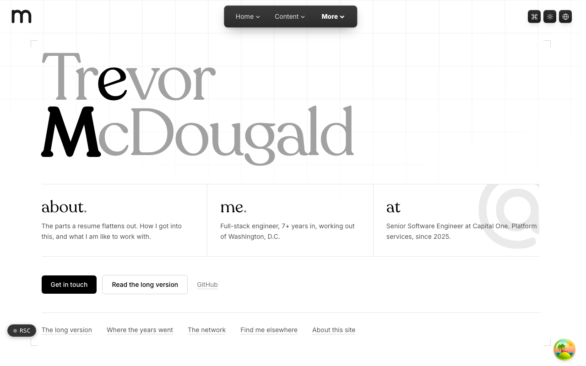

  <picture>
    <source media="(prefers-color-scheme: dark)" srcset=".github/assets/hero-dark.png">
    
  </picture>

# about.me.at

About Trevor McDougald: the background, skills, and journey of a full-stack software engineer.

about.me.at is a single-page site. It holds the parts a resume flattens out: how I got into software, where the years went, the tools I reach for, and how to find me elsewhere. It is deliberately the smallest shape in the family: one page, authored inline, with no content pipeline and no client-side fetching.

**Live:** [about.me.at](https://about.me.at)

## Features

- **One static page**: a hero, a toolbox band, a facts strip, then the story, work history, network, elsewhere, and colophon sections, prerendered to static HTML.
- **Toolbox by job**: tools grouped into labelled columns by what they are used for, with the primary stack emphasized.
- **Facts strip**: years of experience, career track, and location, kept in one place so they stay current.
- **Structured identity**: schema.org `AboutPage` JSON-LD and an IndieWeb h-card on the page.
- **Verified profiles**: outbound profile links are allowlisted and published as `rel="me"` and `sameAs`.
- **Calm motion**: CSS-only animation that stops under `prefers-reduced-motion`, in a grayscale palette with light and dark themes.

## Built with

- Next.js 16 (App Router), React 19, TypeScript
- Tailwind CSS 4
- next-intl for localized family chrome
- Shared `*.me.at` app shell (header, footer, theme, auth)

## Part of the me.at family

about.me.at is one of the [`*.me.at`](https://me.at) apps by Trevor McDougald. They share one design system, account, and app shell. Development happens in a private monorepo; this repository is the project's public-facing home.

## License

See [LICENSE](LICENSE).
